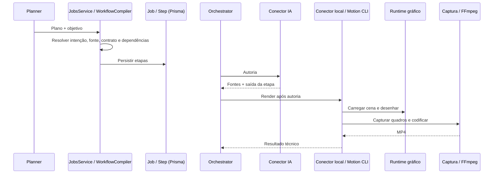

# Blueprint — módulo de Motion

id: nivoo.module.motion
estado: parcial (fronteiras implementadas; aceitação integrada pendente)
Fonte metodológica: [Architecture Blueprint](../../../apps/backend/modelos-prontos/studio-workflow/architecture-blueprint.md). Referência metodológica, sem declarar liberação de ativo draft.

## Responsabilidade e limites

Transformar uma intenção audiovisual em composição e renderização conectadas por fonte e dependências. A autoria responde pela criação; a ferramenta responde pela geometria, renderização e publicação técnica. Não pertence ao módulo: credenciais de IA, fila, ciclo de vida do job, armazenamento geral, revisão artística humana ou regras de outros especialistas.

## Componentes e conectores

| Componente | Responsabilidade | Fonte real |
|---|---|---|
| Fachada de aplicação | Interface pública existente do Motion | `src/jobs/motion-core-routing.ts` |
| Workflow | Liga autor e executor; ordem e dependências | `src/jobs/motion/workflow.ts` |
| Intenção | Compatibilidade com briefings legados em texto | `src/jobs/motion/intent.ts` |
| Conector de fonte | Tradução para entrada do CLI e seleção da fonte | `src/jobs/motion/source.ts` |
| Contrato de autoria | Formato de autoria e saída por modalidade | `src/jobs/motion/authoring.ts` |
| Tipos | Vocabulário interno | `src/jobs/motion/types.ts` |
| Fachada gráfica | API browser estável e serialização de módulos instalados | `bin/motion-graphics.js` |
| Geometria | Malhas e primitivas, independentes de backend | `bin/motion/graphics/geometry.js` |
| Matemática | Vetores, câmera, cores e interpolação | `bin/motion/graphics/math.js` |
| WebGL | Backend de desenho acelerado | `bin/motion/graphics/webgl.js` |
| Software | Backend de projeção e desenho por CPU | `bin/motion/graphics/software.js` |
| Composition root | Composição das dependências e API comum dos backends | `bin/motion/graphics/runtime.js` |
| Contrato gráfico | Instruções das operações reais de autoria | `bin/motion/graphics/authoring.js` |
| Captura/exportação | Relógio, quadros, cache, FFmpeg | `bin/motion-offline-render.js` |
| Entrada CLI | Compatibilidade com jobs existentes, carrega fontes e overlays | `bin/nivoo-renderizar-motion` |
| Motor 2D | Cenas e overlays declarativos (ainda não segmentado) | `bin/motion-scene-core.js` |

Caminhos da tabela são relativos a `apps/backend/`. Leia **o arquivo completo dono da responsabilidade**, o contrato que ele usa e consumidores relevantes antes de editar; busca textual serve para localização, não para substituir leitura. Não editar o motor gráfico para corrigir um problema de planejamento, nem o workflow para corrigir uma malha.

## Dependências e consumidores

- `JobsService.validatePlan/create` → `workflow/compile-plan.ts` → `motion-core-routing.ts` → `motion/workflow.ts` → intenção, fonte, autoria.
- Autor → contrato de autoria → fachadas gráfica e de cena (ainda acopladas ao bin instalado por compatibilidade).
- CLI de render e prévia → fachada gráfica → composição runtime → matemática, geometria e backend selecionado.
- `motion-offline-render.js` → versões de todos os módulos gráficos na chave de cache.
- `PlannerService` e `StepExecutorService` → contrato gráfico; não dependem de shaders ou malhas diretamente.

## UML — sequência do fluxo produtivo

## Contratos e invariantes

- `AiProvider`: `src/providers/provider.interface.ts`. A fila e os provedores continuam existentes.
- `Job/Step`: `prisma/schema.prisma` (sem migração nesta frente).
- API gráfica: `bin/motion/graphics/runtime.js`, `geometry.js`. Mesmas fábricas no namespace e no renderer, ambos os backends.
- Composição declarativa: `bin/motion-scene-core.js`.
- Nenhuma nova sessão de revisão ou gate foi criada. A autoria adicionada quando o plano a omite recebe o contrato de saída que a criação de job já exige.
- Render só depende do autor quando identificado pelo workflow. Jobs antigos continuam compatíveis.
- Alterar módulo gráfico invalida quadros antigos pelo fingerprint do motor.

## Testes e lacunas

Fonte dos testes: `test/motion-core-wiring-smoke.cjs`, `test/motion-offline-render-smoke.cjs`, `test/unit/motion-render-route.spec.ts`. Comparação direta da lógica anterior com a modularizada cobriu 15 cenários; as cinco fábricas de geometria e os traces de desenho foram comparados (WebGL simulado, não render real). Build global e execução integrada no POCOU não comprovados nesta frente.

Lacunas: definição persistida de operações tipadas (hoje ainda existe interpretação de texto/CLI), executor Motion dedicado, divisão do motor declarativo, ciclo de reparo do worker e convergência de contratos dos perfis persistidos. O catálogo de especialidades e a aceitação de capacidades precisam de ligação explícita ao runtime, não apenas novos textos. Esses itens não estão declarados prontos.
